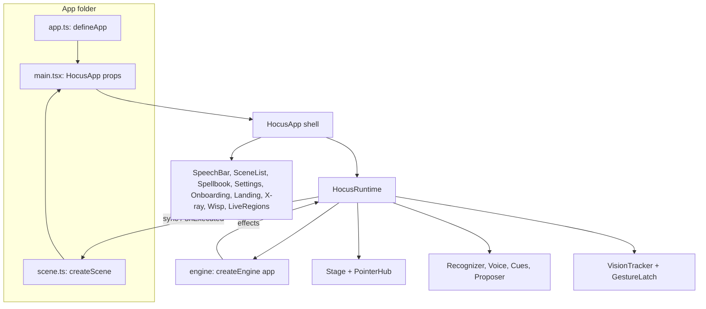

# Design: app-sdk

## Overview

An app is three files: `src/app.ts` (the `defineApp` contract), `src/scene.ts` (a `SceneController` built on the
shared `Stage`) and `src/main.tsx` (mounts `<HocusApp>` with a Judge Mode script and app links). The engine
never sees React or three.js; the runtime connects them.



## Components

| File | Responsibility | Requirements |
|---|---|---|
| `packages/core/src/app.ts` | `SlotKind`, `ActionSpec`, `AppDefinition`, `AppVocabulary`, `EntitySpec`, `defineApp`, `bindingToArg` | 1 |
| `packages/ui/src/runtime.ts` | `HocusRuntime` (`attachStage`, `dispatch`, `handle`, `typed`, `key`, `command`, `select`, `pushToTalk`, `startCamera`, `updateSettings`, `playJudge`, `stopJudge`), `SceneController`, `JudgeStep`, `Settings`, `DEFAULT_SETTINGS`, `loadSettings` / `saveSettings` | 2.2-2.4, 4.3, 5.1, 5.2 |
| `packages/ui/src/components/HocusApp.tsx` | `HocusApp` (runtime, `window.__hocus`), `Shell` (stage lifecycle, theme attributes, key map, kiosk timer, top bar, panels, X-ray mount) | 2.1, 2.5, 2.6, 3.4, 5.3, 5.4 |
| `packages/ui/src/components/SceneList.tsx` | Scene list with roving focus and the actions menu | 3.1, 3.3 |
| `packages/ui/src/components/SpeechBar.tsx` | Mic, transcript chips, countdown, ask options, typed box, undo / redo | 3.2, 3.4 |
| `packages/ui/src/components/Drawers.tsx` | `Spellbook`, `SettingsDrawer` (Radix Dialog) | 4.1-4.3 |
| `packages/ui/src/components/Onboarding.tsx` | Five-step onboarding with lag measurement | 4.4 |
| `packages/ui/src/components/Landing.tsx` | Landing overlay, `AppLink` | 4.5 |
| `packages/ui/src/components/Overlays.tsx` | `Wisp`, `LassoTrail`, `CameraPreview`, `LiveRegions`, `Toasts`, `JudgeCaption`, `Loading` | 2.5, 3.5 |
| `packages/ui/src/hooks.ts` | `useRuntime`, `useUi`, `useCore` (engine state via `useSyncExternalStore`) | 2.4 |
| `packages/ui/src/index.ts` | Public exports, `appLinks()` with `VITE_*_URL` overrides | 2.1 |
| `packages/ui/src/i18n/*.ts` | Interface strings for `en`, `hi`, `ta` | 2.5 |
| `tools/create-hocus-app/package.json` | Declares the `create-hocus-app` bin (`./src/index.mjs`); the script itself is not written | 6.1 |
| `scripts/check-app-size.mjs` | Budget check, writes `docs/app-size.md` | 6.2-6.4 |

## SceneController contract

```ts
interface SceneController<S> {
  sync(state: S, runtime: HocusRuntime<S>): void;          // after every document change
  onExecuted?(action: string, args: Record<string, unknown>, ids: string[]): void; // bursts, camera moves
  dispose(): void;
}
```

The scene reads app state and never writes it. It registers pointable objects with `stage.register(id, root)`
and placement surfaces with `stage.addSurface(name, mesh)`.

## Effect handling

| Effect | Runtime action |
|---|---|
| `announce` | `ui.announcement` → `LiveRegions` (polite `status`, assertive `alert`) |
| `speak` | `Voice.speak` in the pack's language |
| `highlight` | `Stage.highlight(ids, mode)` (violet hover, teal locked, amber numbered ambiguous) |
| `sound` | `Cues.play` |
| `toast` | `runtime.toast` (max 3, 4.5 s) |
| `executed` | `scene.onExecuted` |
| `calibrated` | `updateSettings({ lagMs })` |
| `decision` | `ui.selectedDecision` for the X-ray |

## Actions menu

`SceneList` offers only actions whose slot kinds are all in `object`, `objects`, `factor`, `number`, `color`,
`boolean` (or that have optional slots), so actions that need a place, an entity type or a quantity are not in
the menu. Apps cover those with their own panels: the room designer's Crypt palette (`place` at the centre),
nudge buttons (`move` by 0.8 units) and "Start over"; the planet explorer's true-scale, quiz, faster, slower and
reset buttons.

## Judge Mode and kiosk mode

`playJudge(steps)` switches the hub to `mouse`, then for each step moves a synthetic pointer in 18 eased steps of
25 ms to the target, holds it for 16 jittered samples of 30 ms, and plays the sentence word by word (140 ms per
interim, final 250 ms after the last word). Pointer moves are real `pointermove` events on the stage container,
so hit testing and the engine are the same as for a person.

Kiosk mode checks `URLSearchParams.has('kiosk')` every 5 s. After 120 s without `pointermove` or `keydown`
(and not in Judge Mode) it sends `undo` until the undo stack is empty and shows the landing overlay.

## Size budget

| App | Budget | Behaviour lines today (`docs/app-size.md`) |
|---|---|---|
| `apps/room-designer` | 300 | 223 |
| `apps/planet-explorer` | 300 | 208 |
| `examples/kitchen-board` | 150 | 82 |

## Correctness properties

| Id | Property | Requirements |
|---|---|---|
| P13 | Voice + pointing, click + typed command, and the `command` path give the same document | 3.2 |

`tests/unit/apps.test.ts` checks for the three real apps that lexicon lint has no errors, that every Spellbook
example parses to its own action in every language, and that selectable ids and labels are unique.

## Error handling

- `defineApp` throws at load time for reserved names and undeclared optional slots.
- Settings that fail to load or save (private mode) fall back to `DEFAULT_SETTINGS`.
- Camera and speech denials become toasts; mouse and typing keep working.

## Known gaps

- The kiosk code comment says "attract via Judge Mode", but the code only resets and shows the landing overlay;
  it does not start Judge Mode by itself.
- The room designer's `move` action has `menuLabel: 'Move to centre'`, but `move` needs a place slot, so the
  menu never shows it.
- `tools/create-hocus-app` contains only `package.json`; its bin `src/index.mjs` does not exist. The skill
  `.kiro/skills/new-hocus-app` named in `product.md` does not exist either.
- `product.md` says each app stays under about 300 lines of app-specific code; the script budgets only
  `src/app.ts` and reports the rest (room designer: 458 screen-design lines) without a limit.
- `npm run dev:lab` points at a workspace `@hocus/lab` that does not exist.
- There are no Playwright or axe tests yet (`tests/e2e/` and `playwright.config.ts` are missing), although
  `npm run test:e2e` is defined.
