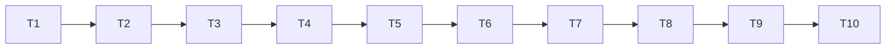

# Implementation Plan: app-sdk

## Overview

Tasks for the app-sdk spec. Checkbox state reflects the current code; each task cites the requirements it covers. Tasks marked with `*` are optional test tasks.

## Tasks

- [x] 1. App definition contract (`packages/core/src/app.ts`)
  - [x] 1.1 `SlotKind`, `ActionSpec`, `AppDefinition`, `AppVocabulary`, `EntitySpec`
    - _Requirements: 1.1, 1.4, 1.5_
  - [x] 1.2 `defineApp` validation (reserved names, optional slots) and freeze
    - _Requirements: 1.2, 1.3, 1.6_
  - [x] 1.3 `bindingToArg`
    - _Requirements: 1.4_

- [x] 2. Runtime (`packages/ui/src/runtime.ts`)
  - [x] 2.1 `HocusRuntime`: engine, Zustand UI store, adapters, session log, `dispatch`
    - _Requirements: 2.3, 2.4_
  - [x] 2.2 Effect handling (`handle`) and `SceneController` contract
    - _Requirements: 2.2, 2.3_
  - [x] 2.3 Settings with `localStorage` persistence and `updateSettings`
    - _Requirements: 4.3_

- [x] 3. Shell (`packages/ui/src/components/HocusApp.tsx`)
  - [x] 3.1 Stage and scene lifecycle, top bar, panels, overlays
    - _Requirements: 2.1, 2.5_
  - [x] 3.2 Theme, contrast, large-target, motion and `lang` attributes
    - _Requirements: 2.6_
  - [x] 3.3 Global key map
    - _Requirements: 3.4_

- [x] 4. Keyboard and mouse parity
  - [x] 4.1 `SceneList` with roving focus and the actions menu
    - _Requirements: 3.1, 3.3_
  - [x] 4.2 Live regions (polite results, assertive questions)
    - _Requirements: 3.5_
  - [x] 4.3 Menu entry for place-based actions (for example the room's "Move to centre"), which the menu filter excludes today
    - _Requirements: 3.3_

- [x] 5. Help and setup
  - [x] 5.1 Spellbook with search, "Try it", basics and languages
    - _Requirements: 4.1, 4.2_
  - [x] 5.2 Settings drawer
    - _Requirements: 4.3_
  - [x] 5.3 Onboarding (language, camera, point, lag, try)
    - _Requirements: 4.4_
  - [x] 5.4 Landing overlay and `?skipLanding`
    - _Requirements: 4.5_

- [x] 6. Judge Mode
  - `playJudge` with synthetic pointer and word-by-word speech, captions, `stopJudge` on Esc
  - _Requirements: 5.1, 5.2_

- [x] 7. Kiosk and test hooks
  - [x] 7.1 `?kiosk`: large targets, 2-minute idle reset to landing
    - _Requirements: 5.3_
  - [x] 7.2 Kiosk attract loop that starts Judge Mode when idle (mentioned in the code comment, not implemented)
    - _Requirements: 5.3_
  - [x] 7.3 `window.__hocus` in dev builds or with `e2e` in the URL
    - _Requirements: 5.4_

- [x] 8. Scaffolder (`tools/create-hocus-app`)
  - [x] 8.1 Package with the `create-hocus-app` bin entry
    - _Requirements: 6.1_
  - [x] 8.2 `src/index.mjs` that writes `src/app.ts`, `src/scene.ts`, `src/main.tsx`, config and public assets
    - _Requirements: 6.1_
  - [x] 8.3 Generated passing test for the new app
    - _Requirements: 6.1_

- [x] 9. Size budget
  - `scripts/check-app-size.mjs` (300 / 300 / 150 on `src/app.ts`), `docs/app-size.md`, part of `npm run lint`
  - _Requirements: 6.2, 6.3, 6.4_

- [x] 10. Tests
  - [x]* 10.1 Property test P13 (`tests/properties/P13-modality-parity.prop.test.ts`)
    - _Requirements: 3.2_
  - [x]* 10.2 Real apps: lint, Spellbook examples, unique selectables (`tests/unit/apps.test.ts`)
    - _Requirements: 1.1, 4.1_
  - [x]* 10.3 Playwright + axe on each app with mouse and typed commands (`tests/e2e/*.spec.ts`, `playwright.config.ts`, not written)
    - _Requirements: 3.1, 3.2, 3.4, 3.5_
  - [x]* 10.4 Unit test that `defineApp` rejects reserved names and undeclared optional slots
    - _Requirements: 1.2, 1.3_

## Task Dependency Graph

Tasks build on each other in numeric order, so each wave holds one top-level task. Sub-tasks of a task run in its wave.



```json
{
  "waves": [
    {
      "id": 0,
      "tasks": [
        "1.1",
        "1.2",
        "1.3"
      ]
    },
    {
      "id": 1,
      "tasks": [
        "2.1",
        "2.2",
        "2.3"
      ]
    },
    {
      "id": 2,
      "tasks": [
        "3.1",
        "3.2",
        "3.3"
      ]
    },
    {
      "id": 3,
      "tasks": [
        "4.1",
        "4.2",
        "4.3"
      ]
    },
    {
      "id": 4,
      "tasks": [
        "5.1",
        "5.2",
        "5.3",
        "5.4"
      ]
    },
    {
      "id": 5,
      "tasks": [
        "6"
      ]
    },
    {
      "id": 6,
      "tasks": [
        "7.1",
        "7.2",
        "7.3"
      ]
    },
    {
      "id": 7,
      "tasks": [
        "8.1",
        "8.2",
        "8.3"
      ]
    },
    {
      "id": 8,
      "tasks": [
        "9"
      ]
    },
    {
      "id": 9,
      "tasks": [
        "10.1",
        "10.2",
        "10.3",
        "10.4"
      ]
    }
  ]
}
```

## Notes

- Requirement ids refer to `requirements.md` in this folder and are cited by test titles; do not renumber them.
- Do not mark a task done until its code and tests exist.
