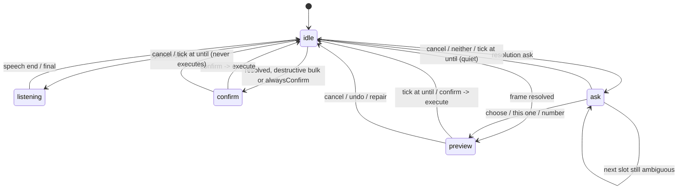

# Design Document

## Overview

The dialogue manager is a set of inner functions of `createEngine` in `packages/core/src/engine.ts`. `step`
dispatches on the event type; speech, keys, gestures, ticks and commands each move `CoreState.phase`. Every
outcome is a new state plus a list of effects (announce, speak, highlight, sound, executed, decision,
calibrated). The runtime (`packages/ui/src/runtime.ts`) only turns user input into events and effects into
DOM, audio and 3D changes.

## Architecture

The dialogue manager is part of `engine.step` in `packages/core/src/engine.ts`: a phase machine driven only by event times. See Overview for the phases and Components for the responsibilities.

## Components and Interfaces
| Function (`engine.ts`) | Responsibility | Requirements |
|---|---|---|
| `step` | Advances `state.t`, routes events (`pointer`, `speech`, `select`, `lasso`, `key`, `gesture`, `tick`, `calibrate`, `config`, `lang`, `command`) | 1.1, 2.1, 6 |
| `onSpeech` | `start` → listening and new track; `interim` → `trackInterim`; `end`; `final` / `typed` → `onUtterance` | 1.2 |
| `onUtterance` | Wake word, parse, alternatives, `pointAction` rewrite, control routing, `no_action` record, word times, snapshot | 1.6, 7.1, 7.2 |
| `propose` / `runResolve` | Resolve a snapshot with forced bindings; build the `DecisionRecord`; enter preview, confirm or ask; or announce `no_target` / `no_action` | 1.3-1.5, 3.6 |
| `execute`, `finish`, `pushHistory` | Run the reducer or the `__name` change, push undo, effects, back to idle, set `lastActed` and `last` | 4.1-4.3, 4.5 |
| `cancelPhase`, `undo`, `redo` | Cancel with or without announcement; whole-document undo and redo | 3.2, 4.4 |
| `chooseOption`, `onControl` | Ask answers, `thisOne` scoring among options, `neither`, `whatWasThat`, routing of control intents | 3.3-3.5, 7.4 |
| `repair` | "other one" and "not that", exclusions, forced runner-up, `calibrateLag` | 5 |
| `onKey` | `confirm`, `cancel`, `undo`, `redo`, `choose` for keys and gestures | 3.1, 3.2 |
| `onTick` | Preview executes; ask expires quietly; confirm cancels | 2.2-2.4 |
| `onCommand` | Direct commands with concrete args from menus and buttons | 7.3 |

| Runtime piece | Responsibility | Requirements |
|---|---|---|
| `HocusRuntime` tick timer (50 ms) | Sends `tick` only in preview, ask, confirm | 2.5 |
| `HocusRuntime.key`, `command`, `select` | Keyboard and button input as events | 3, 7.3 |
| `HocusRuntime.handle` (`calibrated`) | Stores the lag in Settings | 6.4 |
| `HocusApp.tsx` key map | Enter, Esc, 1-9, Ctrl+Z, Ctrl+Shift+Z | 3.1-3.3, 4.4 |
| `SpeechBar.tsx` | Countdown ring, Run / Confirm / Cancel buttons, numbered ask options, undo and redo buttons | 3.1-3.3, 4.4 |
| `GestureLatch` (`packages/vision`) | Held thumbs-up / open palm → one `gesture` event | 3.1, 3.2 |

## Timers

| Name | Default | Effect when reached |
|---|---|---|
| `previewMs` | 600 ms | execute |
| `askTimeoutMs` | 8000 ms | idle, highlights cleared, no announcement |
| `confirmTimeoutMs` | 8000 ms | cancel ("Cancelled."), never execute |
| runtime tick | 50 ms | only while a timer is running |

## Details

### Pending commands and snapshots

`propose` stores the snapshot and the resolution on `Pending`, so an ask answer, a repair or the X-ray can
resolve the same inputs again. Ask phases keep `partial` bindings, so a two-slot command ("compare this with
that") can ask about the second slot after the first is settled.

### Repair

`repair` takes the pending command (preview or confirm) or `state.last` (the last executed command). It finds
the first word bound by pointing with at least one candidate, adds its object to `exclude`, and either forces the
next candidate (`otherOne`) or resolves again (`notThat`). For a spoken command with a first-seen time it calls
`calibrateLag` over the stored samples and applies the nudged lag before proposing.

### Direct commands

`onCommand` is the keyboard and mouse path for menus. It does not resolve and does not record a
`DecisionRecord`; it collects ids from object slots, checks the confirmation rule and executes.

## Data Models

State is `CoreState<S>` (`packages/core/src/engine.ts`). Inputs are `HocusEvent` values, outputs are `Effect` values and `DecisionRecord`s, all defined in `packages/core/src/types.ts`; tunable values are in `FusionConfig` (`packages/core/src/config.ts`).

## Correctness Properties

### Property 1: P08 Undo k times restores the document from k steps ago; redo walks back

**Validates: Requirements 4.1, 4.4**

Full reference: 4.1, 4.4 (fusion-engine 5.4)

### Property 2: P12 Destructive bulk actions never run without confirmation, including on timeout

**Validates: Requirements 2.4, 3.6**

Full reference: 2.4, 3.6 (fusion-engine 5.5)

### Property 3: P19 Names stay unique and consistent through undo and redo

**Validates: Requirements 4.5**

Full reference: 4.5 (fusion-engine 4.3, 4.4)

### Property 4: P20 Lag stays in bounds and converges after repairs

**Validates: Requirements 5.5, 6.1**

Full reference: 5.5, 6.1 (fusion-engine 6.5, 6.6)

### Property 5: P06 Same event log, same states, effects and decisions (keys and ticks included)

**Validates: Requirements 2.1**

### Property 6: P13 Voice, typed and menu paths give the same document

**Validates: Requirements 7.3**

Full reference: 7.3 (app-sdk 3.2)

`tests/unit/engine.test.ts` covers preview then execute after 600 ms, cancel in preview, ask answered by "2",
"no, the other one", destructive confirmation that never runs on timeout, naming, and the typed path.

## Error Handling

- Keys, gestures and control phrases that do not apply to the current phase return the state unchanged.
- An ask option index out of range is ignored.
- Every path that does not execute announces why, except the quiet ask expiry (fusion-engine 5.8) and a bare
  "this one" outside an ask when the app has no `pointAction`.

## Testing Strategy

Property tests are listed under Correctness Properties. `npm run check` runs the determinism lint, the app-size budget, the typecheck and all tests (unit, properties, replays).

## Known gaps

> **Status (2026-11-22):** this list was written by the spec-review pass before the fixes. Items now marked `[x]` in `tasks.md` are fixed; see `docs/kiro-journal.md`.

- `command` events skip preview and produce no `DecisionRecord`, so menu actions do not appear in the X-ray
  or in a replay's expected decisions.
- When `onCommand` enters `confirm`, it announces but does not highlight the objects or play the `ask` cue, unlike
  the spoken path.
- A bare "this one" outside an ask, in an app without `pointAction`, gives no feedback.
