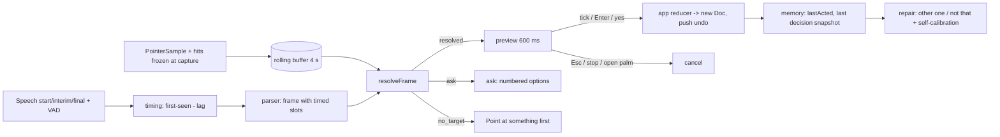

# Design: fusion-engine

## Overview

`@hocus/core` is a pure TypeScript library. The whole engine is one function:

```ts
engine.step(state: CoreState<S>, event: HocusEvent): { state: CoreState<S>; effects: Effect[] }
```

Adapters (pointer hub, vision, speech, keyboard) only *produce* events. The engine never reads a clock,
never touches the DOM, and never mutates its input. Replay, the X-ray, `hocus-mcp`, the benchmark and every
property test fold the same event log through the same function.



## Components

| File | Responsibility | Requirements |
|---|---|---|
| `types.ts` | Data contracts: events, samples, slots, bindings, resolutions, decision records, effects | 1.1 |
| `schemas.ts` | Zod schemas for every event and replay file; `validateEvent` names the bad field | 1.6 |
| `timing.ts` | Word-time estimation from interims, token position and VAD | 6.1-6.4 |
| `evidence.ts` | `timeWeight`, `stability`, `scoreCandidates`, `decide`, `dwellSegments` | 2.2-2.5 |
| `resolver.ts` | `resolveFrame`: the only place words become ids/places | 2, 3, 4 |
| `calibration.ts` | Lag nudging after repairs | 6.5-6.6 |
| `engine.ts` | Dialogue manager, safety, undo/redo, names, repair, decision records | 1, 4.3-4.6, 5, 7 |
| `geometry.ts` | Lasso loop detection and area-inside test, spatial places | 3.5, spatial words |

## Parameters

All live in `DEFAULT_CONFIG` (`config.ts`) and are clamped by `patchConfig`.

| Name | Default | Meaning |
|---|---|---|
| `windowBefore` / `windowAfter` | 800 / 300 ms | Evidence window around `tWord` |
| `minEvidence` | 0.08 | Weighted seconds needed to bind (≈ 80 ms of perfect, stable pointing in the plateau) |
| `margin` | 0.15 | Ask when `(best - second) / best` is below this |
| `stabilitySpeed` | 0.6 px/ms | Speed at which stability halves |
| `maxDt` | 100 ms | Cap on credit for a single sample (tracking gaps) |
| `lagMs` | 350 ms | Recognizer lag subtracted from interim first-seen time |
| `typedLookback` | 1500 ms | Window for typed commands |
| `previewMs` / `askTimeoutMs` / `confirmTimeoutMs` | 600 / 8000 / 8000 ms | Dialogue timers |
| `itOverrideEvidence` | 0.2 | Fresh pointing needed to override memory for "it" |
| `calibrationRate`, `lagMin`, `lagMax` | 0.3, 100, 1200 | Self-calibration |

### Time weight

`d = t_sample - tWord`: ramps 0.5 → 1 over `[-before, -before+150]`, plateau 1 until `-50`, then falls to 0.3 at
`+after`, 0 outside. People point first, then speak, so the plateau sits before the word.

### Evidence

`evidence(obj) = Σ timeWeight · conf · hitQuality · stability · dt`, with `stability = 1 / (1 + (v / v0)²)`.
Hits are computed when the sample is captured (objects orbit or move), so the resolver never re-hit-tests.

### Decision

1. Capability filter (type constraint) removes candidates first. It never adds.
2. best < `minEvidence` → selection → (Hindi/Tamil pronouns) memory → `no_target`.
3. `(best - second)/best < margin` → `ask` with every candidate within the margin.
4. Otherwise bind; confidence = best / total.
5. Typed commands with N object words take the last N distinct dwell segments in order, then the selection order.

## Correctness properties

Each property is a fast-check test in `tests/properties/` whose title cites the requirement.

| Id | Property | Requirements |
|---|---|---|
| P01 | A ≥250 ms dwell in the 800 ms before the word binds that object | 2.1 |
| P02 | Shifts of ≤100 ms in tWord inside one dwell keep the binding | 2.6 |
| P03 | Near-equal evidence asks and offers both | 2.3 |
| P04 | No pointing evidence → `no_target`, document unchanged | 2.4 |
| P05 | Unknown words never crash and never change the document | 1.6 |
| P06 | Same log → identical state, effects and decisions | 1.3 |
| P07 | Several pointing words bind in spoken order | 2.7 |
| P08 | Undo k times restores the document from k steps ago; redo walks back | 5.4 |
| P09 | One Euro output never leaves the input range | pointer-input 2.3 |
| P10 | Grammar sentences parse to their expected frame; random text never throws | lexicon-parser 1.1, 1.4 |
| P11 | "it" → memory unless fresh pointing ≥ `itOverrideEvidence` | 4.1, 4.2 |
| P12 | Destructive bulk actions never run without confirmation | 5.5 |
| P13 | Voice + pointing, click + typing and the actions menu give the same document | app-sdk 3.2 |
| P14 | Reordering Hindi/Tamil tokens gives the same frame | lexicon-parser 2.2 |
| P15 | Type constraints only remove candidates; non-colorable objects never get recoloured | 4.5 |
| P16 | A fast sweep never beats a stable dwell of equal duration | 2.5 |
| P17 | Lasso selects only objects mostly inside the loop | 3.5 |
| P18 | Folding a prefix equals stepping n times | 1.4 |
| P19 | Names stay unique and consistent through undo and redo | 4.3, 4.4 |
| P20 | Lag stays in bounds and converges monotonically | 6.5, 6.6 |

`scripts/sanity-mutants.mjs` breaks one rule at a time (margin, stability, confirmation, word order, undo,
type constraint, "it" override) and checks that the named property catches it.

## Error handling

- Malformed events are rejected at the boundary (`validateEvent`) with the field path; the state is unchanged.
- Unknown phrases produce `no_action` + a hint taken from the app's own examples.
- Every non-execution outcome announces why (point first, show the size, nothing else it could be).
