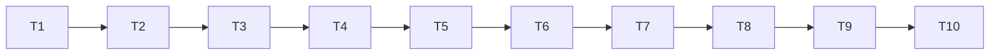

# Implementation Plan: fusion-engine

## Overview

Tasks for the fusion-engine spec. Checkbox state reflects the current code; each task cites the requirements it covers. Tasks marked with `*` are optional test tasks.

## Tasks

- [x] 1. Data contracts and validation
  - Write `types.ts` (events, samples with frozen hits, slots, bindings, resolutions, decision records, effects)
  - Write Zod schemas and `validateEvent` that names the bad field
  - _Requirements: 1.1, 1.6_

- [x] 2. Deterministic foundations
  - `DEFAULT_CONFIG` + `patchConfig` clamps, `createRng(seed)`, One Euro filter as pure math
  - `scripts/check-determinism.mjs` bans wall clock, `Math.random`, timers and browser globals in core
  - _Requirements: 1.5_

- [x] 3. Evidence scoring
  - [x] 3.1 `timeWeight`, `stability`, `prepareSamples`, `scoreCandidates`, `decide`
    - _Requirements: 2.2, 2.3, 2.5_
  - [x] 3.2 `dwellSegments` for typed multi-word commands
    - _Requirements: 6.4_
  - [x]* 3.3 Property tests P01, P02, P03, P15, P16
    - _Requirements: 2.1, 2.3, 2.5, 2.6, 4.5_

- [x] 4. Word timing
  - [x] 4.1 `trackInterim` first-seen times; `estimateWordTimes` with position and VAD fallbacks
    - _Requirements: 6.1, 6.2, 6.3_
  - [x]* 4.2 Property test P07 (spoken order)
    - _Requirements: 2.7_

- [x] 5. Resolver
  - [x] 5.1 Object words, anaphors with memory, plurals with lasso, kinds ("every bat"), names
    - _Requirements: 2.1, 3.3, 3.4, 3.6, 4.1, 4.2, 4.3_
  - [x] 5.2 Places, quantities ("this big"), spatial words ("next to this")
    - _Requirements: 3.1, 3.2_
  - [x] 5.3 Type constraints before scoring; implicit "it" for a missing object slot
    - _Requirements: 4.5_
  - [x]* 5.4 Property tests P04, P11, P17
    - _Requirements: 2.4, 3.5, 4.1, 4.2_

- [x] 6. Dialogue manager and safety
  - [x] 6.1 Preview with countdown, cancel/confirm by key, voice and gesture
    - _Requirements: 5.1, 5.2, 5.3_
  - [x] 6.2 Ask with numbered options, ordinals, "this one" by pointing; quiet expiry
    - _Requirements: 5.8, 5.9_
  - [x] 6.3 Confirmation for destructive bulk actions; never on timeout
    - _Requirements: 5.5_
  - [x] 6.4 Undo/redo of the whole document (app state + names)
    - _Requirements: 5.4, 4.4_
  - [x] 6.5 Repair: "no, the other one", "not that"; self-calibration of the lag
    - _Requirements: 5.6, 5.7, 6.5, 6.6_
  - [x]* 6.6 Property tests P08, P12, P19, P20
    - _Requirements: 4.4, 5.4, 5.5, 6.5, 6.6_

- [x] 7. Explainability
  - [x] 7.1 `DecisionRecord` with samples, candidates, parts, params and context; keep the last 20
    - _Requirements: 7.1, 7.2_
  - [x] 7.2 `reresolve` / `reresolveRecord` for live tuning
    - _Requirements: 7.3_

- [x] 8. Replay and determinism
  - [x] 8.1 `replay(engine, events)`; replay corpus in `tests/replays/`
    - _Requirements: 1.3, 1.4_
  - [x]* 8.2 Property tests P05, P06, P18
    - _Requirements: 1.3, 1.4, 1.6_

- [x] 9. Mutation checks
  - `scripts/sanity-mutants.mjs` (hand-picked) and `stryker.config.json` (full)
  - _Requirements: all_

- [x] 10. Live preview
  - [x] 10.1 `engine.preview(state, text, t, typed?)` runs the same parser, timing and resolver on a partial or typed transcript, without changing state or emitting effects
    - _Requirements: 7.4, 7.5_
  - [x] 10.2 `engine.liveEvidence(state, t)` returns the evidence ranking for a hypothetical pointing word
    - _Requirements: 7.6_
  - [x]* 10.3 Property test P21 (`tests/properties/P21-preview-honest.prop.test.ts`)
    - _Requirements: 7.4, 7.5, 7.6_

## Task Dependency Graph

Tasks build on each other in numeric order, so each wave holds one top-level task. Sub-tasks of a task run in its wave.



```json
{
  "waves": [
    {
      "id": 0,
      "tasks": [
        "1"
      ]
    },
    {
      "id": 1,
      "tasks": [
        "2"
      ]
    },
    {
      "id": 2,
      "tasks": [
        "3.1",
        "3.2",
        "3.3"
      ]
    },
    {
      "id": 3,
      "tasks": [
        "4.1",
        "4.2"
      ]
    },
    {
      "id": 4,
      "tasks": [
        "5.1",
        "5.2",
        "5.3",
        "5.4"
      ]
    },
    {
      "id": 5,
      "tasks": [
        "6.1",
        "6.2",
        "6.3",
        "6.4",
        "6.5",
        "6.6"
      ]
    },
    {
      "id": 6,
      "tasks": [
        "7.1",
        "7.2"
      ]
    },
    {
      "id": 7,
      "tasks": [
        "8.1",
        "8.2"
      ]
    },
    {
      "id": 8,
      "tasks": [
        "9"
      ]
    },
    {
      "id": 9,
      "tasks": [
        "10.1",
        "10.2",
        "10.3"
      ]
    }
  ]
}
```

## Notes

- Requirement ids refer to `requirements.md` in this folder and are cited by test titles; do not renumber them.
- Do not mark a task done until its code and tests exist.
