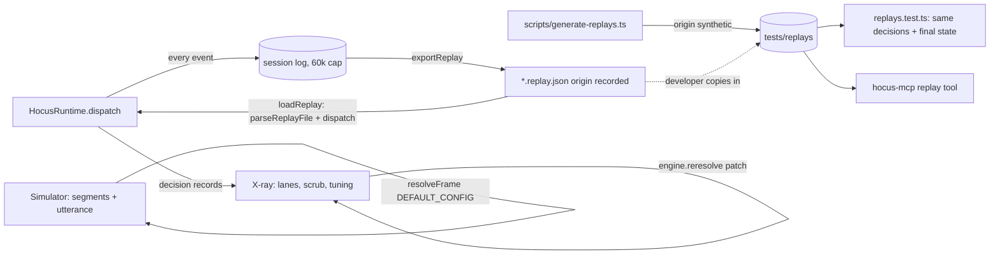

# Design: hocus-lab

## Overview

Hocus Lab adds no decision logic. The X-ray draws `DecisionRecord`s and calls `engine.reresolve`; the simulator
calls `parse` and `resolveFrame` directly; the recorder is the runtime's event log; replays are folded with
`replay(engine, events)`. Because the engine is a pure function of the event log, a replay file reproduces a
session's decisions exactly, and the corpus guards against regressions.

## Components

| File | Responsibility | Requirements |
|---|---|---|
| `packages/devtools/src/XRay.tsx` | `XRay` (tabs Decision / Simulator / Recorder, history pills, `TUNABLE` sliders, scrub, reset, export, copy test, load), `Lanes`, `segments`, `nearest`, `shiftFrame` | 1, 2.1, 2.4 |
| `packages/devtools/src/Simulator.tsx` | `Simulator`: segment list, utterance, first word time, `run()` | 4 |
| `packages/devtools/src/summary.ts` | `summarize(resolution)`: one sentence per status | 1.6, 4.3 |
| `packages/devtools/src/index.ts` | Exports; `testSnippet(appImport, replayPath)` | 2.4 |
| `packages/ui/src/runtime.ts` | `log`, `MAX_LOG`, `exportReplay(description)`, `loadReplay(json)`, `playJudge` (see app-sdk) | 2.1-2.3, 2.5 |
| `packages/ui/src/components/HocusApp.tsx` | Mounts the X-ray; downloads the export as a file; copies `testSnippet` to the clipboard | 2.2, 2.4 |
| `packages/core/src/schemas.ts` | `ReplayFileSchema`, `parseReplayFile` | 2.3, 2.5, 3.1 |
| `packages/core/src/engine.ts` | `replay`, `reresolve`, `reresolveRecord` | 1.4, 3.2 |
| `scripts/generate-replays.ts` | Six scripted sessions: `dwell`, `SCRIPTS`, skip recorded files | 3.4, 3.5 |
| `tests/replays/replays.test.ts` | Corpus test for all three apps | 3.2, 3.3 |
| `tools/hocus-mcp/src/engine-tools.ts` | `runReplay(path)` used by the MCP `replay` tool | 3.6 |

## X-ray lanes

The lanes are one SVG, 760 units wide, from `tFinal − 2600` to `tFinal + 600`:

- **Pointed:** samples grouped into segments by top hit (quality above 0.3), coloured per object, opacity
  `0.35 + 0.65 × stability` with the same `1 / (1 + (v / 0.6)²)` stability as the engine.
- **Words:** each timed word's window (violet band), its `tWord` (amber line) and `"word" → label`.
- **Decision:** status, the top 4 candidates of the first word with candidates, evidence bars scaled to
  `max(2 × minEvidence, best)`, and a red dashed `minEvidence` line.

Tuning keeps a `patch` in component state. For lag, the record's frame is copied with every `tWord` shifted by
`record.params.lagMs − patch.lagMs` (typed commands are not shifted), then `engine.reresolve(record, patch)` runs.

## Replay corpus

| File | App | Origin | What it checks |
|---|---|---|---|
| `room-bigger-put-there.replay.json` | room-designer | synthetic | "make that bigger" on Pumpkin 1, then "put it there" on the floor |
| `room-name-and-repair.replay.json` | room-designer | synthetic | "call this one Boris", typed "make Boris bigger", "turn this green", typed "undo" |
| `planets-compare.replay.json` | planet-explorer | synthetic | "compare this with that", Mars then Earth in spoken order |
| `planets-quiz.replay.json` | planet-explorer | synthetic | typed "start the quiz", then "that one" on Venus |
| `planets-hindi.replay.json` | planet-explorer | synthetic | Hindi "यह क्या है" on Jupiter |
| `kitchen-double.replay.json` | kitchen-board | synthetic | "double this" on the pumpkin purée |

The generator places pointer samples at 30 Hz (hit quality 1, confidence 0.9, 1 px jitter), timestamps interims
350 ms before the end of each dwell (or at explicit offsets), and adds two ticks after each step so every
preview executes before the next step.

## Correctness properties

| Check | Where | Requirements |
|---|---|---|
| Every corpus file reproduces its decisions and final state | `tests/replays/replays.test.ts` | 3.2 |
| The MCP replay tool reports a match for the committed corpus | `tests/unit/mcp.test.ts` | 3.6 |
| Same log, same result; prefix replay equals stepping | P06, P18 (fusion-engine 1.3, 1.4) | 3.2 |

## Error handling

- `parseReplayFile` throws on an invalid file before the session is touched.
- `reresolve` returns `null` for records without a frame (for example `no_action`), and the X-ray then shows
  the recorded resolution.
- The simulator does nothing if the parsed action is not in the app.

## Known gaps

- `loadReplay` starts from `engine.initial({ lang })` and ignores the file's `config` (lag, minimum evidence),
  while `replays.test.ts` and `runReplay` apply it, so a loaded session can resolve differently in the browser.
- Loading dispatches all events at once through the runtime, so sounds and announcements fire in a burst; a
  failed load shows no error message (the exception is unhandled in the file input's handler).
- `testSnippet` imports `../../apps/<id>/src/app.ts`, which is the wrong folder for `examples/kitchen-board`, and
  names the file `./<id>-<seq>.replay.json` while the export is named `<id>-<timestamp>.replay.json`. It also
  ignores the file's language and config.
- The simulator always uses `DEFAULT_CONFIG`, not the session's current parameters.
- `room-name-and-repair` is described as containing "no, the other one", but its steps do not include a repair.
- All six corpus files are synthetic; no recorded session has been committed yet.
- `npm run dev:lab` points at a workspace `@hocus/lab` that does not exist; the Lab is only reachable inside each
  app through the X-ray.
