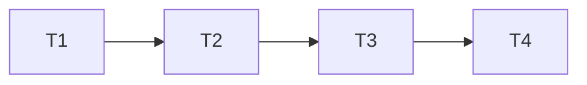

# Implementation Plan: kitchen-board

## Overview

Tasks for the kitchen-board spec. Checkbox state reflects the current code; each task cites the requirements it covers. Tasks marked with `*` are optional test tasks.

## Tasks

- [x] 1. App definition (`examples/kitchen-board/src/app.ts`)
  - [x] 1.1 Cards, selectables, `show`
    - _Requirements: 1.1, 1.2_
  - [x] 1.2 Actions `next`, `read`, `timer`, `double`, `done` with en / hi / ta verbs and examples
    - _Requirements: 2.1, 2.2, 2.3, 2.4, 2.5, 2.6_

- [x] 2. Scene and mount
  - [x] 2.1 `createKitchenScene` with canvas-texture cards
    - _Requirements: 1.3_
  - [x] 2.2 `main.tsx` with the 4-step Judge Mode script
    - _Requirements: 3.3_

- [x] 3. Checks
  - [x]* 3.1 `tests/unit/apps.test.ts` and `tests/replays/kitchen-double.replay.json`
    - _Requirements: 2.1, 2.6, 3.3_
  - [x] 3.2 Size budget 150 lines (`npm run app-size`)
    - _Requirements: 3.2_

- [x] 4. Running timers with a countdown and an alert
  - _Requirements: 2.2_

## Task Dependency Graph

Tasks build on each other in numeric order, so each wave holds one top-level task. Sub-tasks of a task run in its wave.



```json
{
  "waves": [
    {
      "id": 0,
      "tasks": [
        "1.1",
        "1.2"
      ]
    },
    {
      "id": 1,
      "tasks": [
        "2.1",
        "2.2"
      ]
    },
    {
      "id": 2,
      "tasks": [
        "3.1",
        "3.2"
      ]
    },
    {
      "id": 3,
      "tasks": [
        "4"
      ]
    }
  ]
}
```

## Notes

- Requirement ids refer to `requirements.md` in this folder and are cited by test titles; do not renumber them.
- Do not mark a task done until its code and tests exist.
