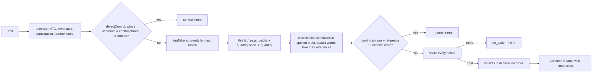

# Design Document

## Overview

`parse(text, ctx)` in `packages/core/src/parser.ts` is a pure function. The engine builds the context with
`engine.parseContext(state)`: the language pack, the app's actions (slots, optional, defaults, examples), the
app vocabulary for the current language, the name map (user names plus unique labels, lowercase → id) and
the entity kinds. The parser never reads pointer data and never binds a word to an object.



## Architecture

The parser (`packages/core/src/parser.ts`) turns text into a `CommandFrame` using the language packs in `packages/core/src/lexicon/` (`en.ts`, `hi.ts`, `ta.ts`). It is pure and has no knowledge of pointing evidence; the resolver binds slots later. See Overview for the pipeline.

## Components and Interfaces
| File | Responsibility | Requirements |
|---|---|---|
| `packages/core/src/parser.ts` | `tokenize`, `tagTokens`, `timedWords`, `parse`, `timedSlots`, `withWordTimes`; internal `buildEntries`, `tokenMatches`, `levenshtein1`, `detectControl`, `collectRefs`, `available`, `hintFor` | 1-6 |
| `packages/core/src/lexicon/types.ts` | `LexiconPack` data contract (documents the `@` implicit triggers) | 2.6 |
| `packages/core/src/lexicon/en.ts`, `hi.ts`, `ta.ts` | Data-only packs. `ta` sets `prefixMatch`; `hi` and `ta` set `postpositions` and mark pronouns `alsoAnaphor` | 2.3-2.6, 3.1 |
| `packages/core/src/lexicon/index.ts` | `PACKS`, `getPack(lang)`, `LANGS` | 2.6 |
| `packages/core/src/lint.ts` | `lintLexicon(app?, packs?)` → `LexiconIssue[]` | 7 |
| `tools/hocus-mcp/src/cli-lint-lexicon.ts` | `npm run lexicon:lint`: lints the packs and every registered app, exits 1 on errors | 7.5 |
| `packages/core/src/messages.ts` | `MESSAGES`, `msg(lang, key, params)`, `joinOptions(lang, labels)` | 8 |
| `packages/core/src/engine.ts` | `parseContext(state)` builds `ParseContext`; `namesMap` adds unique labels and user names | 1.6 |

## Tagging

`buildEntries(ctx)` turns the pack and the app vocabulary into entries `{ tokens, tag, prio }`. Verb phrases
shared by several actions become one entry with a sorted action list. Entries starting with `@` are not
phrases; they only mark implicit triggers.

| Priority | Tags |
|---|---|
| 0 | names (user names, unique labels) |
| 1 | deictics, anaphors |
| 2 | spatial phrases, naming phrases |
| 3 | verbs |
| 4 | colours, size (double, half, much up, much down), entity nouns |
| 5 | size (up, down) |
| 6 | quantity heads, numbers, ordinals |
| 7 | booleans, "all" words |
| 8 | articles |
| 9 | fillers |

`tagTokens` walks the tokens left to right. At each position it takes the longest matching entry; ties go to
better match quality (`exact` < `prefix` < `fuzzy`) and then to the lower priority number. Unmatched tokens
become `unknown`. `tokenMatches` allows a prefix match only when the pack sets `prefixMatch` and the phrase has
at least 3 code points, and a fuzzy match (`levenshtein1`) only for verb, noun, colour and size entries where
both sides are Latin letters and at least 5 long.

A second pass turns `object` deictic + quantity head into a `quantity` deictic and turns the head into a filler.
English uses heads (`big`, `large`, `wide`, `tall`, `long`, `small`, `size`); Hindi and Tamil have no heads and
list quantity deictics directly.

## Reference collection

`collectRefs` runs two passes:

1. Each tag becomes an item: deictics and anaphors get `order` (spoken order of timed words) and
   `tokenIndex`; names become `named`; nouns become `kind` references or entity types depending on the article
   before them; colours, sizes, numbers and booleans go to their own lists.
2. Each spatial item takes the nearest unused object or plural items, looking forward (English) or backward
   (`postpositions`). `between` takes two. The result is a `spatial` place value. Remaining items go to the
   object, plural, place and quantity queues.

## Action scoring and slot filling

For each action with at least one verb hit or implicit trigger:

```
score = 3 * verbTokens + implicit + fit
implicit: @color + colour word = 2, @sizeUp/@sizeDown + size word = 2, @quantity + quantity word = 5
fit: +1 per slot that can be filled; -1 for a missing required object, -2 for any other missing required slot
```

Ties: more verb tokens, then declaration order. Slots are then filled in declaration order from the queues:
`object` from objects (skipping a bare-noun kind already used as the entity type), `objects` from plurals then
objects, `place`, `quantity`, `entityType`, `factor` (product of all size factors), `number`, `color`, `boolean`
(first value), `name` (all unknown words in original casing). The order of words in the sentence only matters
inside one queue, so Hindi and Tamil SOV order and English SVO give the same frame.

## Control phrases

`detectControl` strips "please", the wake words (`hocus`, `हॉकस`, `ஹோகஸ்`) and definite articles, then compares
the whole remaining utterance with each control list in a fixed order. Ordinals are compared after also
removing "one", "वाला" and "ஒன்று". Because the match is on the whole utterance, "make that bigger" never
triggers `thisOne` even though "that" is a `thisOne` phrase.

## Data Models

Output types are in `packages/core/src/types.ts` (`CommandFrame`, `SlotValue`, `ControlIntent`, `ParseResult`). A language pack is a `LexiconPack` (`packages/core/src/lexicon/types.ts`). Apps supply an `AppVocabulary` (`packages/core/src/app.ts`).

## Correctness Properties

### Property 1: P10 Every grammar sentence (scale, recolor, move, compare, delete, rotate, with polite prefixes and tails) parses to its expected action and literals; random grapheme strings never throw

**Validates: Requirements 1.1, 1.4**

### Property 2: P14 Every permutation of eight Hindi/Tamil commands gives the same action and slots

**Validates: Requirements 2.2**

### Property 3: P05 Any text in any language: `step` never throws and `no_action` leaves the document unchanged

**Validates: Requirements 1.4**


Unit tests in `tests/unit/parser.test.ts` cover examples for requirements 1-6 (including homophones, naming,
spatial words, Hindi and Tamil prefix matching). `tests/unit/apps.test.ts` runs `lintLexicon` on the three apps
and checks that every Spellbook example parses to its own action in every language.

## Error Handling

- Any string is accepted. Empty input and unmatched input return `no_action` with a hint; nothing throws.
- Unknown words never cause a guess: they are only used as a name, and only when a naming phrase is present
  (or the action has a `name` slot).
- Lint issues are data (`severity`, `lang`, `code`, `message`), so the MCP tool, the CLI and tests share them.

## Testing Strategy

Property tests are listed under Correctness Properties. `npm run check` runs the determinism lint, the app-size budget, the typecheck and all tests (unit, properties, replays).

## Known limitations

- Homophones are applied per token, so the Hindi entry `'छोटा सा'` (two words) never matches.
- `buildEntries` rebuilds the entry list on every `tagTokens` call. This is simple and deterministic but not
  cached.
- Hindi and Tamil wording was drafted with AI help and has not been reviewed by a native speaker yet
  (`docs/kiro-journal.md`, where the review should be recorded, does not exist).
