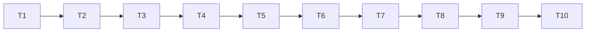

# Implementation Plan: lexicon-parser

## Overview

Tasks for the lexicon-parser spec. Checkbox state reflects the current code; each task cites the requirements it covers. Tasks marked with `*` are optional test tasks.

## Tasks

- [x] 1. Language packs
  - [x] 1.1 `LexiconPack` type in `lexicon/types.ts` with implicit triggers documented
    - _Requirements: 2.6, 6.1_
  - [x] 1.2 `en`, `hi`, `ta` packs as data; register them in `lexicon/index.ts` (`PACKS`, `getPack`, `LANGS`)
    - _Requirements: 2.3, 2.4, 2.5, 2.6_
  - [ ] 1.3 Native-speaker review of the Hindi and Tamil packs, recorded in `docs/kiro-journal.md`
    - _Requirements: 2.6_

- [x] 2. Tokenizer and tagger
  - [x] 2.1 `tokenize`: NFC, lowercase, quotes, punctuation, per-token homophones
    - _Requirements: 3.1_
  - [x] 2.2 `buildEntries` with priorities; `tagTokens` greedy longest match with exact/prefix/fuzzy quality
    - _Requirements: 2.3, 3.2, 3.3, 3.4, 3.5_
  - [x] 2.3 "this big" pass: object deictic + quantity head becomes a quantity word
    - _Requirements: 6.3_

- [x] 3. Control phrases
  - `detectControl` on the whole utterance, fixed order, ordinals without "one"
  - _Requirements: 4.1, 4.2, 4.3, 4.4_

- [x] 4. Reference collection
  - [x] 4.1 Timed slots with `order` and `tokenIndex`; names, kinds, entity types, literals
    - _Requirements: 1.2, 1.5, 1.6, 2.5_
  - [x] 4.2 Spatial words take their references forward or backward (`postpositions`)
    - _Requirements: 2.4, 6.4_

- [x] 5. Naming
  - `__name` frame with original-casing name
  - _Requirements: 5.1, 5.2, 5.3_

- [x] 6. Action scoring and slot filling
  - [x] 6.1 Score `3 × verbs + implicit + fit`, deterministic tie-break
    - _Requirements: 1.3, 6.1, 6.5_
  - [x] 6.2 Fill slots by kind in declaration order; size factors multiply
    - _Requirements: 2.1, 6.2_
  - [x] 6.3 `no_action` with a hint from the app's examples
    - _Requirements: 1.4_

- [x] 7. Timing helpers for the engine
  - `timedWords`, `timedSlots`, `withWordTimes`
  - _Requirements: 1.2_

- [x] 8. Messages
  - `MESSAGES`, `msg` with English fallback, `joinOptions`
  - _Requirements: 8.1, 8.2, 8.3_

- [x] 9. Lexicon lint
  - [x] 9.1 `lintLexicon`: missing verbs, missing nouns, collisions (allowed `move|place`), empty deictics
    - _Requirements: 7.1, 7.2, 7.3, 7.4_
  - [x] 9.2 `npm run lexicon:lint` CLI (`tools/hocus-mcp/src/cli-lint-lexicon.ts`)
    - _Requirements: 7.5_

- [x] 10. Tests
  - [x]* 10.1 Unit examples in `tests/unit/parser.test.ts`
    - _Requirements: 1.2, 1.5, 1.6, 2.3, 3.1, 4.1, 4.2, 5.1, 5.2, 6.4_
  - [x]* 10.2 Property test P10 (`tests/properties/P10-grammar-roundtrip.prop.test.ts`)
    - _Requirements: 1.1, 1.4_
  - [x]* 10.3 Property test P14 (`tests/properties/P14-free-word-order.prop.test.ts`)
    - _Requirements: 2.2_
  - [x]* 10.4 Property test P05 (`tests/properties/P05-unknown-words.prop.test.ts`)
    - _Requirements: 1.4_
  - [x]* 10.5 App lint and Spellbook examples in every language (`tests/unit/apps.test.ts`)
    - _Requirements: 7.1, 7.2_
  - [x]* 10.6 Unit tests for lint warnings and errors on a deliberately broken fixture app
    - _Requirements: 7.1, 7.2, 7.3, 7.4_

## Task Dependency Graph

Tasks build on each other in numeric order, so each wave holds one top-level task. Sub-tasks of a task run in its wave.



```json
{
  "waves": [
    {
      "id": 0,
      "tasks": [
        "1.1",
        "1.2",
        "1.3"
      ]
    },
    {
      "id": 1,
      "tasks": [
        "2.1",
        "2.2",
        "2.3"
      ]
    },
    {
      "id": 2,
      "tasks": [
        "3"
      ]
    },
    {
      "id": 3,
      "tasks": [
        "4.1",
        "4.2"
      ]
    },
    {
      "id": 4,
      "tasks": [
        "5"
      ]
    },
    {
      "id": 5,
      "tasks": [
        "6.1",
        "6.2",
        "6.3"
      ]
    },
    {
      "id": 6,
      "tasks": [
        "7"
      ]
    },
    {
      "id": 7,
      "tasks": [
        "8"
      ]
    },
    {
      "id": 8,
      "tasks": [
        "9.1",
        "9.2"
      ]
    },
    {
      "id": 9,
      "tasks": [
        "10.1",
        "10.2",
        "10.3",
        "10.4",
        "10.5",
        "10.6"
      ]
    }
  ]
}
```

## Notes

- Requirement ids refer to `requirements.md` in this folder and are cited by test titles; do not renumber them.
- Do not mark a task done until its code and tests exist.
