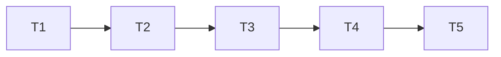

# Implementation Plan: planet-explorer

## Overview

Tasks for the planet-explorer spec. Checkbox state reflects the current code; each task cites the requirements it covers. Tasks marked with `*` are optional test tasks.

## Tasks

- [x] 1. Data
  - `src/data/solar-system.json` with NASA NSSDCA source, URLs, retrieval date 2026-11-22, 10 bodies, 8 quiz questions
  - _Requirements: 1.1, 1.2_

- [x] 2. App definition (`apps/planet-explorer/src/app.ts`)
  - [x] 2.1 Selectables with kind capabilities, `orbits`, `hasMoons`
    - _Requirements: 1.4_
  - [x] 2.2 `describe`, `distance`, `size`, `moons`, `zoom` with replies from the data
    - _Requirements: 1.3, 2.1, 2.2, 2.3, 2.4, 2.5_
  - [x] 2.3 `compare` with `distinct`
    - _Requirements: 3.1, 3.2, 3.3_
  - [x] 2.4 `faster`, `slower`, `scaleMode`, `reset` (all `mutates: false`)
    - _Requirements: 4.1, 4.2, 4.3, 4.5_
  - [x] 2.5 `quiz` and `answer` with `pointAction: 'answer'`
    - _Requirements: 5.1, 5.2, 5.3, 5.4_
  - [x] 2.6 Verbs and examples in en, hi, ta
    - _Requirements: 6.1_

- [x] 3. 3D scene (`scene.ts`)
  - [x] 3.1 Bodies, textures, ring, tilt, orbits, Moon; registration with pick radius 1.15
    - _Requirements: 6.2_
  - [x] 3.2 Readable and true-scale layouts; camera fly-to; moons group
    - _Requirements: 2.4, 2.5, 4.2_
  - [x] 3.3 Hover slow-down to 15%; bursts; reduced motion
    - _Requirements: 4.4, 6.3_

- [x] 4. Mount (`main.tsx`)
  - [x] 4.1 Information panel (quiz, comparison table, body table, source line), scene list, view buttons
    - _Requirements: 1.3, 3.2, 4.5_
  - [x] 4.2 8-step Judge Mode script
    - _Requirements: 6.4_

- [x] 5. Checks
  - [x]* 5.1 App lint, examples and unique selectables (`tests/unit/apps.test.ts`)
    - _Requirements: 6.1_
  - [x]* 5.2 Replays `planets-compare`, `planets-quiz`, `planets-hindi` (`tests/replays/replays.test.ts`)
    - _Requirements: 2.1, 3.1, 5.2_
  - [x] 5.3 Size budget (`npm run app-size`)
    - _Requirements: 6.5_
  - [x]* 5.4 Unit test that the data file matches the NASA sheet values it cites (a fixed snapshot check)
    - _Requirements: 1.2_
  - [x]* 5.5 Tamil replay (only English and Hindi replays exist)
    - _Requirements: 6.1_

## Task Dependency Graph

Tasks build on each other in numeric order, so each wave holds one top-level task. Sub-tasks of a task run in its wave.



```json
{
  "waves": [
    {
      "id": 0,
      "tasks": [
        "1"
      ]
    },
    {
      "id": 1,
      "tasks": [
        "2.1",
        "2.2",
        "2.3",
        "2.4",
        "2.5",
        "2.6"
      ]
    },
    {
      "id": 2,
      "tasks": [
        "3.1",
        "3.2",
        "3.3"
      ]
    },
    {
      "id": 3,
      "tasks": [
        "4.1",
        "4.2"
      ]
    },
    {
      "id": 4,
      "tasks": [
        "5.1",
        "5.2",
        "5.3",
        "5.4",
        "5.5"
      ]
    }
  ]
}
```

## Notes

- Requirement ids refer to `requirements.md` in this folder and are cited by test titles; do not renumber them.
- Do not mark a task done until its code and tests exist.
