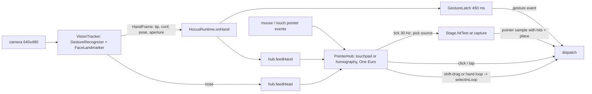

# Design: pointer-input

## Overview

Pointer input is an adapter layer. It reads browser APIs and the camera, and its only output is `HocusEvent`
values (`pointer`, `select`, `lasso`, `gesture`) passed to `HocusRuntime.dispatch`. The math that must be
tested (One Euro filter, polygon tests, loop detection) lives in `packages/core` as pure functions; the hub,
the trackers and the stage use them.

## Components

| File | Responsibility | Requirements |
|---|---|---|
| `packages/core/src/smoothing.ts` | `oneEuroInit`, `oneEuroStep` (pure, caller passes `t`), `OneEuro2D` wrapper with `setParams`, `reset`, `filter` | 2.3, 2.4 |
| `packages/core/src/geometry.ts` | `pointInPolygon`, `rectFractionInPolygon` (7 × 7 grid), `selectInLoop` (threshold 0.6), `detectLoop` | 4.2-4.4 |
| `packages/input/src/mapping.ts` | `touchpadMap` (mirrored pad), `solveHomography` (4-point DLT), `applyHomography` | 2.1, 2.2, 2.6 |
| `packages/input/src/hub.ts` | `PointerHub`: `feedHand`, `feedHead`, `pick`, `tick`, `onDown`/`onUp` click and lasso, `emitLasso`, `setSmoothing`, `setCalibration`, `subscribe` (pointer view for the Wisp) | 1, 2, 3.1, 4 |
| `packages/three/src/stage.ts` | `Stage.hitTest`, `screenOf`, `projectRects`, `toScreen`, `register`, `addSurface` | 3, 4.4 |
| `packages/vision/src/trackers.ts` | `VisionTracker.start`, `stop`, `setHead`, `onStatus`, frame `loop`; `GestureLatch.feed` | 5, 6.4 |
| `packages/vision/src/pose.ts` | `classifyPose`, `aperture`, `pointerAnchor` (pure geometry) | 5.5, 6.1-6.3 |
| `packages/ui/src/runtime.ts` | `attachStage` creates the hub; `onHand` feeds hub and latch, hand-lost toast; `applySmoothing`; camera status toasts | 2.5, 5.4, 6.4, 6.5 |

## Parameters

| Name | Value | Where |
|---|---|---|
| Sample rate | 30 Hz (`hz`) | `HubOptions` |
| Tracker freshness | 500 ms | `PointerHub.pick` |
| Hand filter | `minCutoff 1.0`, `beta 0.01`, `dCutoff 1` (then set from sensitivity) | `PointerHub` |
| Head filter | `minCutoff 0.6`, `beta 0.006`, `dCutoff 1` | `PointerHub` |
| Touchpad pad | 0.6 hand, 0.25 head | `PointerHub.pad`, `feedHead` |
| Click / tap | ≤ 8 px and ≤ 600 ms, top hit ≥ 0.5 | `onUp` |
| Hand loop | trail 2.5 s, close ≤ 45 px, age ≥ 500 ms, perimeter ≥ 300 px | `tick` → `detectLoop` |
| Lasso inside | ≥ 60% of the rect on a 7 × 7 grid | `selectInLoop` |
| Hit margin | stage `margin` (default 18 px, planets 22 px), up to 36 px for large objects | `Stage.hitTest` |
| Video rate | ≥ 30 ms between processed frames | `VisionTracker.loop` |
| Gesture hold | 450 ms | `GestureLatch` |

## Details

### Source selection

`pick(t)` returns the active source for the current mode. `auto`: hand, head, touch, mouse. `hand` and
`head`: that tracker, then the mouse. `touch`: touch only. `mouse`: mouse only. Head samples always have pose
`point`; touch samples are always `point`; mouse samples are `point` inside the stage and `rest` after
`pointerleave`.

### Hit testing

`Stage.hitTest(x, y)` ray-casts the visible registered roots. The first object hit gets quality 1. Every other
visible object is scored from its projected bounding sphere (`screenOf`, or an explicit pick radius such as the
planets' `radius: 1.15`): 0.9 within 80% of the radius, then a linear falloff. This forgiving margin makes small
or moving objects easier to point at. The same ray is cast against surfaces (`addSurface`) to give `place`.

### One Euro filter

`oneEuroStep` computes `alpha = 1 / (1 + tau / dt)` with `tau = 1 / (2π · cutoff)`, so `alpha` is in (0, 1] and
each output is a convex combination of the new input and the previous output. That is why the output can
never leave the range of the inputs (P09). `dt` is floored at 1 ms.

### Poses

`classifyPose` trusts the built-in label only above score 0.6 (the tracker passes it only then), and otherwise
uses finger extension relative to the wrist. Middle-finger state is ignored for `point`, because many people
half-curl it.

## Correctness properties

| Id | Property | Requirements |
|---|---|---|
| P09 | Every One Euro output lies within [min, max] of the inputs seen so far, for any parameters | 2.3 |
| P17 | A lasso selects only objects mostly inside the loop; objects outside the loop's bounding box are never selected | 4.2, 4.4 (fusion-engine 3.5) |

## Error handling

- Camera errors map to `denied`, `no-camera` or `error`; the runtime shows a toast and the mouse keeps working.
- GPU delegate failures fall back to the CPU delegate.
- A tracker that stops reporting is treated as absent after 500 ms; its filter is reset on `null` frames.
- `solveHomography` returns `null` for degenerate point sets.

## Known gaps

> **Status (2026-11-22):** this list was written by the spec-review pass before the fixes. Items now marked `[x]` in `tasks.md` are fixed; see `docs/kiro-journal.md`.

- `solveHomography` and `PointerHub.setCalibration` exist, but no UI collects four calibration points, so the
  touchpad mapping is always used today.
- `PointerHub.paused` ("pause camera pointing while typing") is never set by any caller.
- There are no unit tests for `classifyPose`, `aperture`, `touchpadMap` or the hub. `pose.ts` mentions
  `tests/unit/vision-pose.test.ts`, which does not exist.
- The hub reads `performance.now()` and timers. This is allowed in adapters, not in `packages/core`.
