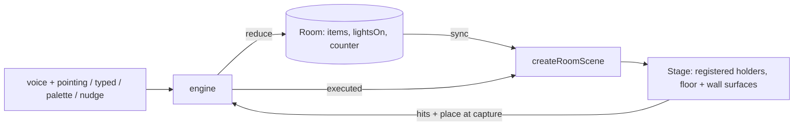

# Design: room-designer

## Overview

The app is a `defineApp<Room>` definition plus a three.js scene that reads the room and never writes it.
Every change goes through an action reducer, so undo, preview, repair and replay come from the skeleton.

## Components

| File | Responsibility | Requirements |
|---|---|---|
| `apps/room-designer/src/app.ts` | `Item`, `Room`, `CATALOG`, `TYPES`, `STARTERS`, `make`, `snap`, `placeFromArg`, `update`, `roomApp` (actions, entities, vocabulary) | 1-5 |
| `apps/room-designer/src/scene.ts` | `createRoomScene`: room shell, surfaces, lights, motes, `sync`, `onExecuted` bursts, frame easing and glow | 6.1-6.3 |
| `apps/room-designer/src/models.ts` | `buildProp(type)`: procedural three.js models with `tintable` materials, `glow` materials and lights, optional `animate` | 4.2, 6.2 |
| `apps/room-designer/src/main.tsx` | Mounts `HocusApp`; `JUDGE` script; Crypt palette, "Start over", nudge buttons, lights toggle; "Export PNG"; right panel `SceneList` | 2.4, 2.5, 4.4, 6.4, 6.5 |

## Actions

| Action | Slots | Flags | Reducer |
|---|---|---|---|
| `place` | `what: entityType`, `where: place` | | `make` at the place, wall surface keeps the wall |
| `move` | `target: object`, `destination: place` | `requires: movable` | new x, z; y kept for non-floor items; `snap` |
| `scale` | `target`, `factor` | default 1.25, `requires: scalable` | `scale × factor` in [0.25, 4] |
| `resize` | `target`, `size: quantity` | `requires: scalable` | `0.4 + 2.6 × size` in [0.25, 4] |
| `rotate` | `target` | | +π/4 |
| `recolor` | `target`, `color` | `requires: colorable` | `tint = color` |
| `duplicate` | `target` | | `make` offset (+0.9, +0.3), copy scale, rotation, tint |
| `delete` | `targets: objects` | `destructive` | filter out ids |
| `front` / `back` | `target` | | z ± 1, `snap` |
| `lights` | `on: boolean` | | `lightsOn` |
| `describe` | `target` | `mutates: false` | none; reply "That is <label>." |
| `reset` | none | `alwaysConfirm` | `STARTERS.crypt` |

Entities are the 14 types with caps `scalable` and, if colourable, `colorable`. Selectables add `movable`.
Nouns cover singular and plural forms per language ("pumpkin", "pumpkins", "jack o lantern"; "कद्दू"; "பூசணி").
The only app verb is `lights`; all other verbs come from the skeleton packs.

## Scene

- Floor (12 × 14) and back wall are `addSurface('floor')` and `addSurface('wall')`, so "there" gives a world
  point and the surface name. `placeFromArg` puts wall placements on the wall plane.
- Each item is a `THREE.Group` holder registered as `item.id`. New holders start at scale 0.01 and ease in.
- `stage.onFrame` eases position, scale and rotation with `damp` (instant with reduced motion), runs prop
  animations, sets glow intensity by `lightsOn` (1.2 / 2.6 emissive, 0.7 / 2.2 light), dims ambient and moon
  light, runs bursts and keeps chips on moving objects.
- Tints map colour names through `NAMED_COLORS`; a `null` tint restores the base colours.

## Correctness properties

| Check | Where | Requirements |
|---|---|---|
| Lint has no errors; every example parses to its action in en, hi, ta; ids and labels unique | `tests/unit/apps.test.ts` | 5.1-5.3 |
| "make that bigger" then "put it there" keeps resolving the same way | `tests/replays/room-bigger-put-there.replay.json` | 2.2, 3.1 |
| Naming, using the name, recolour, undo | `tests/replays/room-name-and-repair.replay.json` | 3.4 |
| `src/app.ts` within 300 lines (223 today) | `scripts/check-app-size.mjs` | 6.6 |

## Error handling

- Positions are always clamped and snapped, so a bad place cannot put an item outside the room.
- A `duplicate` of a missing id returns the room unchanged.
- Recolouring a non-colourable item is prevented by the capability filter before scoring (fusion-engine 4.5).

## Known gaps

- The parlor and graveyard starters exist in `STARTERS` but there is no command or button to load them.
- `move` has `menuLabel: 'Move to centre'`, but the actions menu does not offer place-based actions, so it never
  appears; the nudge buttons are the keyboard path for moving.
- The replay named `room-name-and-repair` does not contain a "no, the other one" step even though its
  description says so (see hocus-lab).
