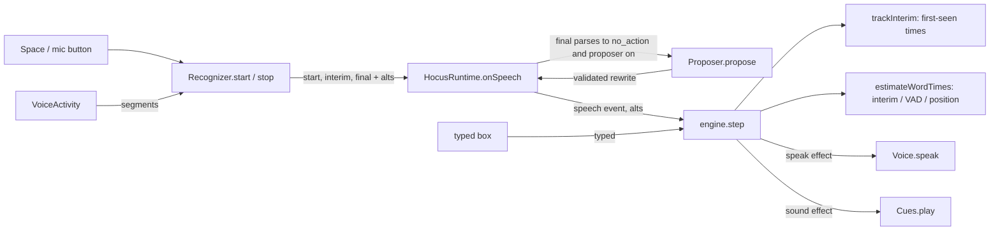

# Design: speech-input

## Overview

The speech adapters produce `SpeechEvent`s (`start`, `interim`, `final`, `end`, `typed`) that the runtime wraps
as `{ type: 'speech' }` events. The engine turns interims into first-seen times with `trackInterim` and, at the
final event, calls `estimateWordTimes`. Output (read-back, cues) only reacts to engine effects. The proposer sits
between the recognizer and the engine and can only add an alternative transcript.



## Components

| File | Responsibility | Requirements |
|---|---|---|
| `packages/speech/src/recognizer.ts` | `Recognizer`: `start` (push-to-talk down), `stop`, `abort`, `setLang`, `checkLocal`, `installLocal`, `lastOnset`, `continuous`; `speechSupported()`; statuses `unsupported`, `idle`, `listening`, `error`, `denied` | 1, 4 |
| `packages/speech/src/vad.ts` | `VoiceActivity`: `start(now)`, `segments()`, `stop()`, live `level` | 3 |
| `packages/core/src/timing.ts` | `newTrack`, `trackInterim`, `estimateWordTimes` (pure) | 2 |
| `packages/core/src/engine.ts` | `onSpeech`, `onUtterance` (alternatives, word times, typed path), `stripWakeWord` | 1.6, 2, 5.2, 5.3, 7.4 |
| `packages/speech/src/output.ts` | `Voice.speak`, `Voice.cancel`; `Cues.play(name)` with oscillator tones | 6 |
| `packages/speech/src/proposer.ts` | `Proposer.check`, `Proposer.propose(utterance, allowed, timeoutMs)` | 7 |
| `packages/ui/src/runtime.ts` | `onSpeech` (proposer call), `pushToTalk`, `typed`, `updateSettings` (language, always listening, voice, sounds, proposer) | 1, 4, 5, 6, 7 |
| `packages/ui/src/components/SpeechBar.tsx` | Mic button, interim line, word chips, typed form, undo/redo | 1.4, 5.1 |
| `packages/ui/src/components/HocusApp.tsx` | Space push-to-talk, ignored inside text fields | 1.1, 5.4 |
| `packages/ui/src/components/Onboarding.tsx` | Measures the lag from the first VAD onset | 3.4 |
| `packages/ui/src/components/Drawers.tsx` | Privacy text, "Try on-device speech", proposer toggle with status | 4.3, 7.1 |

## Word timing

```
start = track.startT ?? finalT - 2000
end   = max(start, finalT - lag)
p     = (tokenIndex + 0.5) / tokenCount
interim = firstSeen != null ? max(start, firstSeen - lag) : null
vad     = position p of the voiced time inside [start, finalT]   (if segments)
t = avg(interim, vad) | interim | vad | start + (end - start) * p
t = min(finalT, t)
```

`trackInterim(track, text, t, count)` sets the first-seen time of every timed word index below `count` that
has none yet. The engine counts timed words in the interim with `timedWords`. Typed commands skip all of
this: every word gets the submit time and the resolver uses the 1.5 s look-back window.

## Voice-activity detection

`VoiceActivity` opens its own microphone stream (echo cancellation and noise suppression on), reads time-domain
data each animation frame and computes RMS. Voiced means `rms > max(0.015, 3 × floor)`; on quiet frames
`floor = 0.98 × floor + 0.02 × rms`. A segment closes 120 ms after the last voiced frame. `segments()` includes
an open segment and drops those shorter than 60 ms. The recognizer attaches the segments to the final event.

## Proposer

`Proposer.check()` maps `LanguageModel.availability()` to `ready`, `downloadable`, `unavailable` or
`unsupported`. `propose` creates one session with a system prompt ("rewrite into exactly one command from the
allowed list, keep pointing words, empty if nothing fits"), sends the allowed list and the utterance with a JSON
`responseConstraint`, and aborts after `timeoutMs` (1500). The answer is parsed with Zod and accepted only if
it normalizes to one of the allowed strings. The runtime puts the result first in `alts`; `onUtterance` tries
alternatives only while the parse is still `no_action`.

## Correctness properties

| Id | Property | Requirements |
|---|---|---|
| P07 | Several pointing words, each first seen in its own interim, bind in spoken order | 2.1, 2.2 (fusion-engine 2.7) |
| P20 | Self-calibration keeps the lag in bounds and converges | fusion-engine 6.5, 6.6 |
| P13 | Typed commands with a click selection give the same document as voice and pointing | 5.1, 5.2 (app-sdk 3.2) |

## Error handling

- Recognition errors map to `denied` or `error`; `no-speech` and `aborted` are ignored.
- VAD failures leave `segments()` empty, so timing falls back to interim and position estimates.
- The proposer catches every failure and returns `null`; a slow model cannot delay a command by more than 1.5 s.
- `speechSynthesis` and `AudioContext` are checked before use.

## Known gaps

> **Status (2026-11-22):** this list was written by the spec-review pass before the fixes. Items now marked `[x]` in `tasks.md` are fixed; see `docs/kiro-journal.md`.


- The VAD opens a second microphone stream next to the recognizer's own.
- `VoiceActivity.level` is computed but no component shows it.
- The proposer session is created with English as its expected language, while the allowed list can be Hindi or
  Tamil examples.
- Validation only checks that the rewrite is one of the examples. The example may use a different pointing word
  than the user said ("that" instead of "this"); binding still comes from pointer evidence and word times.
- The proposer is used only for final speech transcripts, not for typed commands.
- There are no unit tests for `estimateWordTimes`, `VoiceActivity` or `Proposer`; timing is covered indirectly by
  P07, P20 and `tests/unit/engine.test.ts`.
