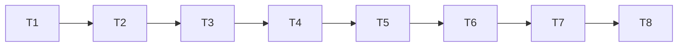

# Implementation Plan: speech-input

## Overview

Tasks for the speech-input spec. Checkbox state reflects the current code; each task cites the requirements it covers. Tasks marked with `*` are optional test tasks.

## Tasks

- [x] 1. Recognizer (`packages/speech/src/recognizer.ts`)
  - [x] 1.1 Push-to-talk `start` / `stop` / `abort`; `start`, `interim`, `final` (with `alts`, `vad`), `end` events
    - _Requirements: 1.1, 1.2, 1.3_
  - [x] 1.2 Statuses and error mapping (`unsupported`, `denied`, ignored `no-speech` / `aborted`)
    - _Requirements: 1.4, 1.5_
  - [x] 1.3 Continuous mode with restart; wake word check in the engine (`stripWakeWord`, `requireWakeWord`)
    - _Requirements: 1.6_

- [x] 2. On-device recognition
  - `checkLocal`, `installLocal`, `processLocally`; privacy line and "Try on-device speech" in Settings
  - _Requirements: 4.1, 4.2, 4.3, 4.4_

- [x] 3. Voice-activity detection (`packages/speech/src/vad.ts`)
  - [x] 3.1 RMS threshold with adaptive floor, 120 ms close, 60 ms minimum
    - _Requirements: 3.1, 3.2, 3.3, 3.5_
  - [x] 3.2 Onboarding lag measurement from `Recognizer.lastOnset`
    - _Requirements: 3.4_

- [x] 4. Word timing (`packages/core/src/timing.ts`)
  - `newTrack`, `trackInterim`, `estimateWordTimes` with interim, VAD and position methods
  - _Requirements: 2.1, 2.2, 2.3, 2.4, 2.5, 2.6_

- [x] 5. Typed fallback
  - Speech bar form, `HocusRuntime.typed`, typed path in `onUtterance`, Space ignored in fields
  - _Requirements: 5.1, 5.2, 5.3, 5.4_

- [x] 6. Output (`packages/speech/src/output.ts`)
  - [x] 6.1 `Voice.speak` for `speak` effects, off by default
    - _Requirements: 6.1, 6.2_
  - [x] 6.2 `Cues.play` tones for lock, run, cancel, ask, error
    - _Requirements: 6.3_

- [x] 7. Proposer (`packages/speech/src/proposer.ts`)
  - [x] 7.1 `check` and `propose` with timeout, Zod schema and allowed-list validation
    - _Requirements: 7.2, 7.3, 7.5_
  - [x] 7.2 Runtime calls it only for `no_action` finals; result passed as the first alternative
    - _Requirements: 7.1, 7.4_

- [ ] 8. Tests
  - [x]* 8.1 Property test P07 (`tests/properties/P07-spoken-order.prop.test.ts`)
    - _Requirements: 2.1, 2.2_
  - [x]* 8.2 Typed path in `tests/unit/engine.test.ts` ("keyboard path: click selection + typed command") and P13
    - _Requirements: 5.1, 5.2_
  - [x]* 8.3 Unit tests for `estimateWordTimes` (each method, clamping to start and final)
    - _Requirements: 2.2, 2.3, 2.4, 2.5_
  - [x]* 8.4 Unit test for `Proposer.propose` with a fake `LanguageModel` (accepts only allowed commands, times out)
    - _Requirements: 7.2, 7.3, 7.5_
  - [ ]* 8.5 Unit test for `VoiceActivity` segmenting with a fake analyser
    - _Requirements: 3.2, 3.3_

## Task Dependency Graph

Tasks build on each other in numeric order, so each wave holds one top-level task. Sub-tasks of a task run in its wave.



```json
{
  "waves": [
    {
      "id": 0,
      "tasks": [
        "1.1",
        "1.2",
        "1.3"
      ]
    },
    {
      "id": 1,
      "tasks": [
        "2"
      ]
    },
    {
      "id": 2,
      "tasks": [
        "3.1",
        "3.2"
      ]
    },
    {
      "id": 3,
      "tasks": [
        "4"
      ]
    },
    {
      "id": 4,
      "tasks": [
        "5"
      ]
    },
    {
      "id": 5,
      "tasks": [
        "6.1",
        "6.2"
      ]
    },
    {
      "id": 6,
      "tasks": [
        "7.1",
        "7.2"
      ]
    },
    {
      "id": 7,
      "tasks": [
        "8.1",
        "8.2",
        "8.3",
        "8.4",
        "8.5"
      ]
    }
  ]
}
```

## Notes

- Requirement ids refer to `requirements.md` in this folder and are cited by test titles; do not renumber them.
- Do not mark a task done until its code and tests exist.
